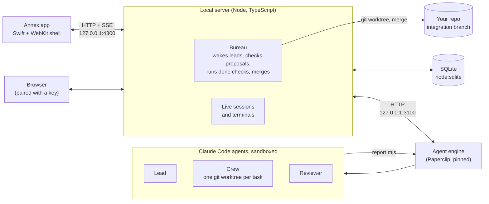

# Annex

A macOS app for running an office of Claude Code agents, where work counts as done only after
it is checked, reviewed and checked again.


Annex organises Claude Code agents into wings. Each wing has a lead, a crew and a reviewer, and
works on one repository. You can plan with a wing's lead in a chat, or hand the wing off so the
lead wakes on a timer, reads the repo's signals and proposes work on its own. Every task runs in
its own git worktree. A task is done only when Annex's own run of its check passes, a separate
reviewer approves the diff, and the check passes again after the merge into the wing's
integration branch. Annex never touches your checkout and never pushes.

It is for people who want several agents working on real projects without trusting an agent's
own claim that "tests pass".

## Features

- Two modes per wing. "With you" plans the work in a chat with the lead; "on its own" wakes the
  lead on a schedule. Several wings can run at once, each in its own mode.
- One git worktree per task, on a branch cut from the wing's integration branch, so crew members
  never share a working copy.
- A three-step done gate. Annex runs the task's check in the worktree, a reviewer agent approves
  the diff against the repo's `CLAUDE.md`, and the check runs again after the merge.
- Proposals are checked in code. A lead's proposed task must cite a charter line, quote real
  signal output and carry a check command, or Annex throws it out.
- Every agent shell runs inside Claude Code's OS sandbox, limited to its worktree, package caches
  and a short list of hosts.
- Your own Claude Code sessions, real terminals (node-pty and xterm.js), a file editor and a
  projects list sit in the same app.
- A wing is one `wing.toml` file. Edits are picked up without a restart.

## Quick start

You need macOS, Node 24.11 or newer, and Claude Code signed in with your subscription.

```sh
git clone https://github.com/gshepptech/annex.git
cd annex
npm install
npm run up      # starts the engine, builds the page, runs the server on 127.0.0.1:4300
npm run open    # opens the page in your browser with its access key
```

Then add an office: copy `examples/wings/upkeep` into `wings/`, point its `[repo]` section at one
of your projects, or use **+ New office** in the sidebar.

To build the self-contained Mac app (needs Xcode for the Swift compiler):

```sh
npm run app:install   # builds Annex.app and copies it to /Applications
npm run app:dmg       # or builds .annex/app/Annex.dmg
```

The app carries its own Node, the server and the engine, and walks a new Mac through installing
and signing in to Claude Code. See [docs/getting-started.md](docs/getting-started.md).

## How it works



- App shell (`app/main.swift`): a native WebKit window on the local server. It installs the
  login service on first launch and turns page alerts into notifications.
- Server (`server/`): plain `node:http` with server-sent events. Node runs the TypeScript
  files directly. `node:sqlite` holds what Annex owns: wing modes, tasks, chat, asks, goals.
- Bureau (`server/bureau.ts`): reacts to engine events and polls every 15 seconds. It wakes leads, files the tasks they
  propose (`proposal.ts`), runs each done check (`run.ts`), hands the diff to the reviewer, and
  merges verified work (`git.ts`).
- Engine (`runtime/`): a pinned [Paperclip](https://www.npmjs.com/package/paperclipai)
  instance runs agent heartbeats and holds their issues. Every call to it lives in
  `server/engine/paperclip.ts`.
- Page (`web/src/`): plain TypeScript and DOM built by Vite. The offices are drawn on a
  canvas and move only when a stored event says so.

More detail is in [docs/architecture.md](docs/architecture.md).

## Configuration

A wing is `wings/<id>/wing.toml` in Annex's data folder (the checkout when run with `npm run up`,
`~/Library/Application Support/Annex` for the app).

```toml
name = "Upkeep"
mode = "autonomous"                      # or "with_you" (the default)
charter = """
1. `npm test` and `npm run typecheck` pass on the integration branch.
"""
done_check = "npm test && npm run typecheck"
setup = "npm ci --no-audit --no-fund"    # run in a fresh worktree before checks
plugins = ["lint-kit@acme"]              # Claude Code plugins for this wing's lead and crew

[repo]
path = "~/Projects/shop"
base_branch = "main"

[[signals]]                              # commands whose output the lead reads on each wake
name = "outdated"
run = "npm outdated --long"

[crew]
workers = 2

[settings]
wake_every = "15m"
ask_before = ["adding a new dependency"]

[permissions]
allow = ["npm", "npx", "node", "git"]
```

The full field list, every screen, and the plugin and sandbox options are in
[docs/usage.md](docs/usage.md).

## What Annex will not do

- Touch your own checkout or base branch, or push. Verified work lands on the integration branch
  and you merge it from the Ready to merge tab.
- Run agents with `--dangerously-skip-permissions`, or with your global `~/.claude/CLAUDE.md`,
  hooks, plugins or auto-memory.
- Let an agent read Annex's access key, write outside its worktree, or reach hosts other than
  package registries, GitHub, Claude and localhost.

## Development

```sh
npm install
npm run typecheck     # server and page
npm test              # node --test, *.test.ts beside the code
npm run web:build     # builds the page into web/dist
npm run web:dev       # serves the page with live reload on :4301
```

Two scripts check Annex against a running engine. Neither wakes an agent, so neither uses
Claude. Both find `claude` the way Annex does (`CLAUDE_COMMAND`, then the usual install folders,
then `PATH`) and stop with an error if there is none.

- `node scripts/check-engine.ts` exercises the engine client: health, websocket events, and
  creating a test company, project and agent. It does not delete them afterwards.
- `node scripts/check-provision.ts` provisions every wing in `wings/` (under `ANNEX_HOME` when
  set) twice and checks the second pass changes nothing. It creates real companies, projects and
  agents in the engine, the same ones Annex itself would make.

`npm run service:install` runs Annex as a macOS LaunchAgent that starts at login;
`npm run service:remove` takes it off.

## License

Copyright 2026 Garrett Sheppard. Licensed under the Apache License, Version 2.0; see
[LICENSE](LICENSE). Annex.app also bundles Node.js and the Paperclip engine, both under the MIT
License.
